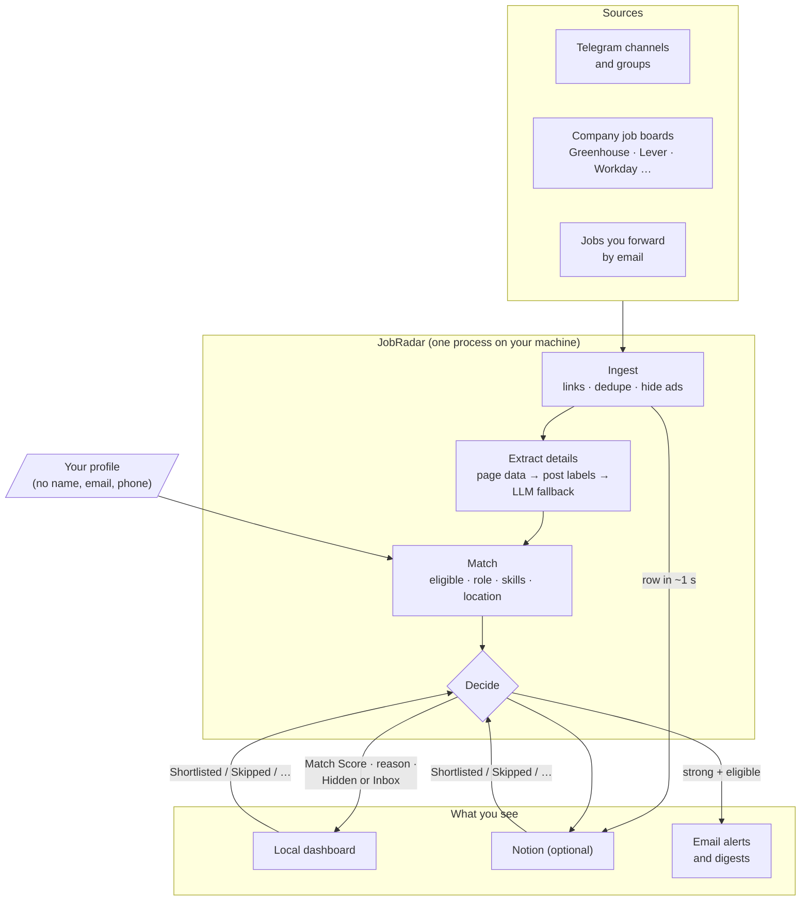

# JobRadar

[](https://hub.xerj.org/contributors/ThePlator)

**One inbox for every new job from company career pages, job boards and the Telegram groups you follow: deduplicated, ranked, and ready to apply.**

**Website:** [jobradar.theplator.dev](https://jobradar.theplator.dev/), see how it works and try the post reader in your browser.

JobRadar is an open-source, self-hosted agent. It reads company career sites directly (Greenhouse, Lever, Ashby, SmartRecruiters, Workday and Oracle boards, plus freehire.me's search across about 90 hiring systems), watches hiring-drive pages and your Telegram job channels, and takes jobs you forward by email. It reads each job page, pulls out each job's details (free rules first, an LLM only when needed), scores how well each job fits your profile, emails you only about strong matches you're eligible for, and lays everything out on a local dashboard (and in Notion, if you want it). You review and apply; JobRadar never applies for you.

> **Status:** pre-1.0, and I use it every day for my own job search. Working today: company boards, hiring-drive pages, Telegram and email-forward sources, dedupe, ad and scam filtering, free extraction with a Gemini fallback, the Match Score, email alerts and digests, closing-deadline reminders, and a local dashboard. Notion and Telegram are optional. Not done yet: a one-command Docker setup and [Jev](https://typesafe.ai/blog/introducing-system-one-models-and-jev) matching. See the [roadmap](#roadmap).

---

## Why

Job hunting means checking dozens of company career pages every day, and if you are a fresher in India, also 10 to 50 Telegram and WhatsApp groups that post hundreds of links a day. Most of those links are duplicates, irrelevant, or scams. Good postings get missed or found days late, deadlines pass, and every application means typing the same answers again.

JobRadar fixes that:

- **Straight from the source.** The company boards you pick are read through their public job APIs every 20 to 30 minutes, so a new posting reaches you minutes after it goes up, not when someone reposts it. `jobradar boards add <careers link>` adds one. Hiring-drive pages are checked every few hours (robots.txt obeyed).
- **And from the groups.** Telegram channels are watched in real time, with backfill on first run, and you can forward any job by email.
- **One job, one row.** A job posted in 10 groups, or one role posted for three cities, shows up once, with a "Seen In" count.
- **Ranked by fit.** Each job is checked against your profile: are you eligible, is it a role you want, do your skills cover it, does the location work. Code turns the answers into a 0–100 Match Score with a reason: *Good fit · 82 · eligible ✓ · Python, SQL ✓ · missing Docker · Remote ✓*.
- **Free first.** Most details come from the job page's structured data and the post's own "Company: … Role: …" lines. An LLM is only called when those fall short: 138 of the first 181 Telegram jobs needed no AI call at all.
- **Scams flagged.** Registration fees, personal-email-only HR and unrealistic pay raise a Scam Risk flag. A likely scam is never emailed.
- **Alerts you can trust.** An email only when a job is a strong match, you're eligible, it's fresh and it isn't a likely scam. One email per job, a daily cap, a morning and evening digest, and closing-deadline reminders.
- **Triage from your inbox.** Tap **Shortlist** or **Not interested** in an email or on the dashboard, and JobRadar remembers it, in its own database and in Notion if you use it.

## Türkiye: the daily gig finder

The same agent, pointed at a different question: **where can I earn today?** Not "is this a
job I want", but "is this work that pays by the day, the hour, the task or the project", in
Ankara or from anywhere in Turkey.

`jobradar gig scan` reads every source in the list below, reads each new ad, and keeps only
what is really short-paid work:

- **The payment model is read from the ad, not from "part-time".** A daily wage, an hourly
  rate, a fee per task and a fee per project are four different things, and each is kept
  apart. An ad that says only "part-time" is not a gig: it goes to the *uncertain* pile
  with the others whose pay nobody wrote down.
- **Full-time, monthly-only and heavy-lifting work is dropped**, with the reason kept
  ("monthly pay only", "heavy physical work", "on site in İzmir, not Ankara and not
  remote").
- **Remote work counts**, wherever the company is.
- **The same ad on two sites is one row**, and the ad's own structured data (when it has
  any) is used before the prose: the date it was posted, who is hiring, where, and the pay.
- **New gigs are emailed as they appear** (`jobradar gig scan`, or automatically while
  `jobradar run` is up, every `gig.every_minutes`).

Sources, in the order they were built and checked: Eleman.net, İşin Olsun, Telegram
(public channel previews), R10, Upwork, DataForce, OneForma, RWS TrainAI, OpenTrain AI,
Bionluk, Armut, Facebook, WhatsApp, Sahibinden, then Kariyer.net, SecretCV, Indeed,
LinkedIn, the Ankara city hall, Contra, Mindrift, Corpshore, Rise Data Labs and TELUS
Digital.

`jobradar gig validate` runs nine checks against each of them (can we reach it, can we read
the list, the ad, the link, the date, the pay, the place, do the results dedupe, does a
second scan find the same ads) and prints what each source can and cannot do. Sources that
answer a challenge page or a 403 are reported as blocked: nothing is worked around. Facebook
and WhatsApp groups are not scraped at all; their ads come in through `jobradar gig add`,
which takes the text you paste or forward.

## How it works



1. **Ingest:** new board postings, page changes and channel messages are saved to a local SQLite queue before anything else happens, so nothing is lost on a restart. Links are expanded and cleaned, duplicates merged, channel ads hidden. The job appears on the dashboard (and in Notion, when on) within a second.
2. **Extract:** the job page is fetched, and details are filled cheapest first: structured data on the page, the post's own labels, then an LLM only if role or company is still missing. Board postings that aren't in India, aren't tech or are senior are skipped before any AI call.
3. **Match:** one LLM request per job answers eligibility, role fit, skills coverage, seniority and location, each with a confidence. Code combines them with your weights into a Match Score and a reason line. Without an LLM key, a skills-overlap rule scores instead (and never alerts).
4. **Decide:** confidently ineligible jobs are hidden with the reason; likely scams are flagged and never emailed; uncertain matches go to the Inbox marked "unsure"; strong, eligible, fresh matches also send an email. The first alert goes out about 30 seconds after the job is matched.
5. **Notify:** a strong, eligible, fresh match also sends an email within about 30 seconds, with the reason it scored what it did and a link to the job.

## Where you see your jobs

**Dashboard.** `jobradar run` also serves a page at http://127.0.0.1:8080, read from JobRadar's own database: **Today** (good matches from the last 3 days you haven't acted on, with filters and search), **All jobs** (full-text search over every job's page and posts), **Skills** (what your good matches ask for that you lack, and for each skill what exactly they want: "AWS, Azure or GCP", "Python, Java or C++", the services they name), the **Digest**, and a page per job (how the score was made, which skills you have or lack, where it was seen, your status history). Buttons change a status, and Notion follows when it's on. It only listens on 127.0.0.1 and refuses requests from other sites; to open it on your phone, share it over your own [Tailscale](https://tailscale.com/) network ([docs/PHONE.md](docs/PHONE.md)).

**Email.** Alerts, digests and reminders have **Shortlist** and **Not interested** buttons that work from your phone's mail app.

**Notion (optional).** Each job can also be one page in a Notion database; JobRadar adds any columns it needs on start. Set `notion.enabled: false` to skip Notion entirely: no Notion account or key is needed, and the dashboard shows everything below.

| Property | What it shows |
|---|---|
| Role, Company, Location, Work Mode | Extracted from the posting |
| Match Score | 0–100 fit against your profile |
| Status | New → Shortlisted (plus Skipped, Hidden) |
| Deadline, Posted On | Application deadline and publish date, if stated |
| Skills, Experience, Salary | Extracted requirements |
| Apply Link | Canonical application URL |
| Seen In | How many of your groups posted it |
| Source | Where it was seen: "Telegram · Freshershunt", "Greenhouse · Stripe" |
| Scam Risk | Low / Medium / High |

Anything you write outside the agent-owned "JobRadar" toggle on a page is never overwritten.

## Quick start

**You need:** Python 3.11+ and [uv](https://docs.astral.sh/uv/), a Gmail account (for alerts, with an app password), and a model: a free [Gemini](https://aistudio.google.com/) or [Groq](https://console.groq.com/) API key, or the local servers that JobRadar installs for you (no key at all, see [Local model servers](#local-model-servers-no-api-key)).

```bash
git clone https://github.com/ThePlator/JobRadar.git
```

```bash
cd JobRadar && cp .env.example .env && uv sync --extra web
```

Fill in `.env` (see [Configuration](#configuration)), then run first-time setup. It copies the example configs into `config/`, logs in to Telegram (a code arrives in your Telegram app; nothing is posted) and checks your Notion database, skipping either one you switched off:

```bash
uv run jobradar init
```

Edit `config/config.yaml` and `config/profile.yaml`. `uv run jobradar chats` lists the Telegram chats you can read, with the ids to paste in. Then start it:

```bash
uv run jobradar run
```

Telegram and Notion are optional: set `sources.telegram.enabled: false` or `notion.enabled: false` in `config/config.yaml` and their keys aren't needed. Alerts start in **dry run**: they're saved to `data/alerts/` instead of sent, so you can check them for a few days before turning email on. To keep it running after you close the terminal, see [docs/COMMANDS.md](docs/COMMANDS.md#start-stop-restart). A Docker image is planned for v1.0.

## Configuration

JobRadar uses three files. All are validated at start-up, and a bad value stops the app with a clear message.

### `.env`: secrets only, never committed

| Variable | Where to get it |
|---|---|
| `TG_API_ID`, `TG_API_HASH` | [my.telegram.org](https://my.telegram.org) → API development tools (not needed with `sources.telegram.enabled: false`) |
| `EMAIL_ADDRESS`, `EMAIL_APP_PASSWORD` | Your email and an app password ([Gmail](https://myaccount.google.com/apppasswords)); used to send alerts and read your own button replies |
| `NOTIFY_TO` | Where alerts and digests go (defaults to `EMAIL_ADDRESS`) |
| `NOTION_TOKEN`, `NOTION_DATABASE_ID` | A Notion internal integration, shared with your database (not needed with `notion.enabled: false`) |
| `GEMINI_API_KEY` or `GROQ_API_KEY` | Google AI Studio or Groq console: extraction fallback and matching. Not needed with the local servers. Without any model, jobs are read from page data and post labels only and scored by the skills rule |

### `config.yaml`: what to watch and how to filter

```yaml
sources:
  telegram:
    chats: ["@offcampusjobs", "@freshersjobs", -1001234567890]
    backfill_days: 3
  boards:
    greenhouse: {Stripe: stripe}
    lever: {Meesho: meesho}
    workday: {NVIDIA: nvidia.wd5.myworkdayjobs.com/NVIDIAExternalCareerSite}

llm:
  extract_model: "gemini-web/gemini-auto"
  extract_mode: fallback    # LLM only when page data and post labels miss role or company
  writer_model: "gemini-web/gemini-auto"
  fallback_models: ["deepseek-web/deepseek-chat"]
  endpoints:
    gemini-web:
      base_url: "http://127.0.0.1:4981/openai/v1"
    deepseek-web:
      base_url: "http://127.0.0.1:9655/v1"
  daily_budget_inr: 15

filters:
  batch_years: [2025, 2026]
  degrees: ["B.Tech", "BE", "MCA"]
  locations: ["Bengaluru", "Hyderabad", "Pune", "Remote"]
  max_experience_years: 1

scoring:
  hide_below: 40          # confident matches below this → Hidden
  alert_above: 75         # at or above, and confident and eligible → email alert

matching:
  providers: [llm, skills_rule]   # tried in order
  weights: {skills_coverage: 0.40, role_alignment: 0.30, seniority_fit: 0.15, location_ok: 0.15}
  min_confidence: 0.5     # below this: marked "unsure", never emailed
  branch_strict: false    # true: "CSE/IT only" jobs count as not eligible
```

Changing `weights` re-ranks your jobs from stored answers at the next start, with no new model calls. Editing `profile.yaml` or `filters` matches open jobs again. `jobradar boards add <link>` adds a company board after checking it exists. [config.example.yaml](config.example.yaml) lists every setting.

### Local model servers (no API key)

JobRadar can run the model itself, on your own machine, so you never hand over an API key:

- **Gemini Web**: [gemini-web-to-api](https://github.com/ntthanh2603/gemini-web-to-api) turns your signed-in Gemini web session into a local API. It needs your browser cookies, so it answers as you.
- **DeepSeek Web**: [FreeDeepseekAPI](https://github.com/atharvotech/FreeDeepseekAPI-EN) does the same for DeepSeek. It needs one login, and it is the fallback when Gemini can't answer.

Both speak the OpenAI API on 127.0.0.1, so JobRadar calls them like any other provider, and no key is needed. Install, start and switch between them:

```bash
uv run jobradar llm setup --cookies ~/cookies.json   # clones both servers, builds, sets the cookie
uv run jobradar llm start                            # runs them on 127.0.0.1
uv run jobradar llm                                 # what they offer and which model is in use
uv run jobradar llm use gemini-web/gemini-auto      # switch the model
uv run jobradar llm test                            # one real question, so you see it answer
uv run jobradar llm login                           # the DeepSeek login (one time)
```

The servers are installed in `services/` (git-ignored) and their logs are in `data/local-llm/`. `jobradar run` starts them for you when the config points at one. The cookie file is your Google session: keep it out of the repository and off shared machines.

### `profile.yaml`: what the matcher knows about you

Your education, skills, experience, projects and preferences. Only what matching needs ever leaves your machine: education, skills, experience, projects and your filters. Your name, email and phone are never sent to a provider.

## CLI

Every command with examples, log reading, settings and fixes: [docs/COMMANDS.md](docs/COMMANDS.md).

| Command | What it does |
|---|---|
| `jobradar init` | Copy example configs, Telegram login, Notion schema check (each only if on) |
| `jobradar run` | Start sources, workers, scheduler and the dashboard |
| `jobradar web` | Only the dashboard |
| `jobradar chats` | List Telegram chats you can read, with ids |
| `jobradar add <url>` | Process one link manually |
| `jobradar boards [add <link> \| remove <name> \| --check]` | Company boards you watch, their health and newest posting |
| `jobradar digest --now` | Send the digest for the current window right away |
| `jobradar alerts --test` | Send yourself one test email to check that alerts reach you |
| `jobradar skills` | Skills your good matches ask for that your profile lacks |
| `jobradar stats [--days 7]` | Posts, jobs, reposts merged, hidden ads, your funnel, failed tasks |
| `jobradar retry --failed` | Re-queue failed tasks |
| `jobradar llm` | The local model servers: what they offer, which model is in use |
| `jobradar llm use <provider/model>` | Switch the model (and the fallback chain stays as it is) |
| `jobradar gig scan` | Scan every source for daily, hourly, per-task and per-project work |
| `jobradar gig list` | The gigs found (or the uncertain ones, or the dropped ones) |
| `jobradar gig sources` | How each source is doing: last read, errors, ads found |
| `jobradar gig validate` | Run the nine source checks and print the report |
| `jobradar gig add` | Add an ad by hand (Facebook and WhatsApp) |

You can also add jobs by forwarding any email, message text or link to your JobRadar mail folder (for Gmail: a `JobRadar` label with a filter).

## Privacy and safety

- **Runs on your machine.** Your profile, keys, Telegram session and database stay local. The dashboard listens only on 127.0.0.1; your phone reaches it only through your own Tailscale network.
- **Minimal data to providers.** Matching sends your LLM provider the job text and a compact profile (education, skills, experience, preferences), never your name, email or phone. Extraction sends only job text.
- **Email stays narrow.** JobRadar uses an app password and emails only you. From your inbox it reads only its own button emails, which are signed and only accepted from your address.
- **Read-only on Telegram.** JobRadar reads with your account, only the chats you list. It never sends messages, joins groups or messages recruiters.
- **You submit every application.** No auto-apply and no scraping behind logins. Company boards are read through their public job APIs; watched pages obey robots.txt.
- **Nothing is scraped around a block.** A source that answers 403 or a bot challenge is reported as blocked and left alone. The gig finder reads public pages and public APIs only, and the ads that need an account (Facebook and WhatsApp groups) come in by hand.
- **Prompt-injection aware.** Job pages are passed to the LLM as delimited data, outputs are schema-validated, and the model has no tools.
- **Guard your session file.** `data/tg.session` gives full access to your Telegram account. It is `chmod 600` and git-ignored; never share it.

> You are responsible for following the terms of service of every platform you connect. The WhatsApp source uses an unofficial client that can get a number banned; it is experimental, off by default, and a spare number is strongly recommended.

## Cost

Most details come from free rules, and dedupe runs before any model call. With Gemini's free tier my own use costs nothing; at list prices an LLM call is about ₹0.10 (≈ $0.001) per job with flash-lite. Answers are cached, and a daily budget cap (`llm.daily_budget_inr`) pauses model work when reached.

## Roadmap

| Release | Scope | State |
|---|---|---|
| **v0.1 Ingest** | Telegram listener, link cleanup, dedupe, ad filtering, SQLite queue, one Notion row per job | ✓ |
| **v0.2 Read and match** | Page reading, free extraction, Match Score, decide step, scam flags, email alerts, digests | ✓ |
| **v0.2.5 Statuses and feeds** | Statuses from Notion and email buttons, company boards, still-open check, closing reminders | ✓ |
| **v0.5 Dashboard** | Local web dashboard, skills page, full-text search, phone via Tailscale; Notion and Telegram optional | ✓ |
| **Matching with Jev** | [Jev](https://typesafe.ai/blog/introducing-system-one-models-and-jev) answers the match questions with calibrated confidence, beside the LLM first | planned |
| **Text-only posts** | Posts without links, poster OCR | planned |
| **v1.0 Public release** | Docker image, PyPI (`jobradar-agent`), setup guide; WhatsApp as experimental | planned: new user running in under 15 minutes |

The resume builder, the ATS check, the apply kit and the application and interview tracking were removed on 1 November 2026. JobRadar now finds, ranks and tells you about jobs; applying is yours.

## Documentation

- [Commands](docs/COMMANDS.md): every command, logs, settings and fixes
- [The dashboard on your phone](docs/PHONE.md): Tailscale in about ten minutes
- [Product Requirements (PRD)](docs/PRD.md): goals, user stories, requirements, metrics, risks
- [High-Level Design (HLD)](docs/HLD.md): architecture, flows, integrations, deployment, security
- [Low-Level Design (LLD)](docs/LLD.md): schema, models, module specs, prompts, Notion mapping, plugins

## Tech stack

Python 3.11+ (asyncio) · Telethon · httpx · trafilatura · LiteLLM + instructor (Gemini or Groq) · SQLite + SQLModel (with full-text search) · FastAPI · Jinja2 · aiosmtplib + imap-tools · Notion API · uv

## Contributing

JobRadar is split into sources, site adapters and sinks, so adding one doesn't touch the core. Discovering them as Python entry points (so a plugin can live in its own package) is planned for v1.0:

| Extension point | Built in | Ideas |
|---|---|---|
| `jobradar.sources` | telegram, boards, pages, email_forward, whatsapp (experimental) | Job-alert emails, RSS, Discord |
| `jobradar.site_adapters` | generic, google_forms | More hiring-site pages |
| `jobradar.sinks` | notion, email_notify | Telegram bot, Slack, Google Sheets |

CI runs ruff, mypy, pytest (579 tests), gitleaks and a Docker build on every change.

Issues and pull requests are welcome. Start with [CONTRIBUTING.md](CONTRIBUTING.md), and please follow the [Code of Conduct](CODE_OF_CONDUCT.md). Changes are listed in [CHANGELOG.md](CHANGELOG.md); for help, see [SUPPORT.md](SUPPORT.md).

## Security

Found a vulnerability? Please report it privately, not in a public issue. See [SECURITY.md](SECURITY.md) for how, what's in scope, and what to do if a secret leaks.

## License

[MIT](LICENSE)
